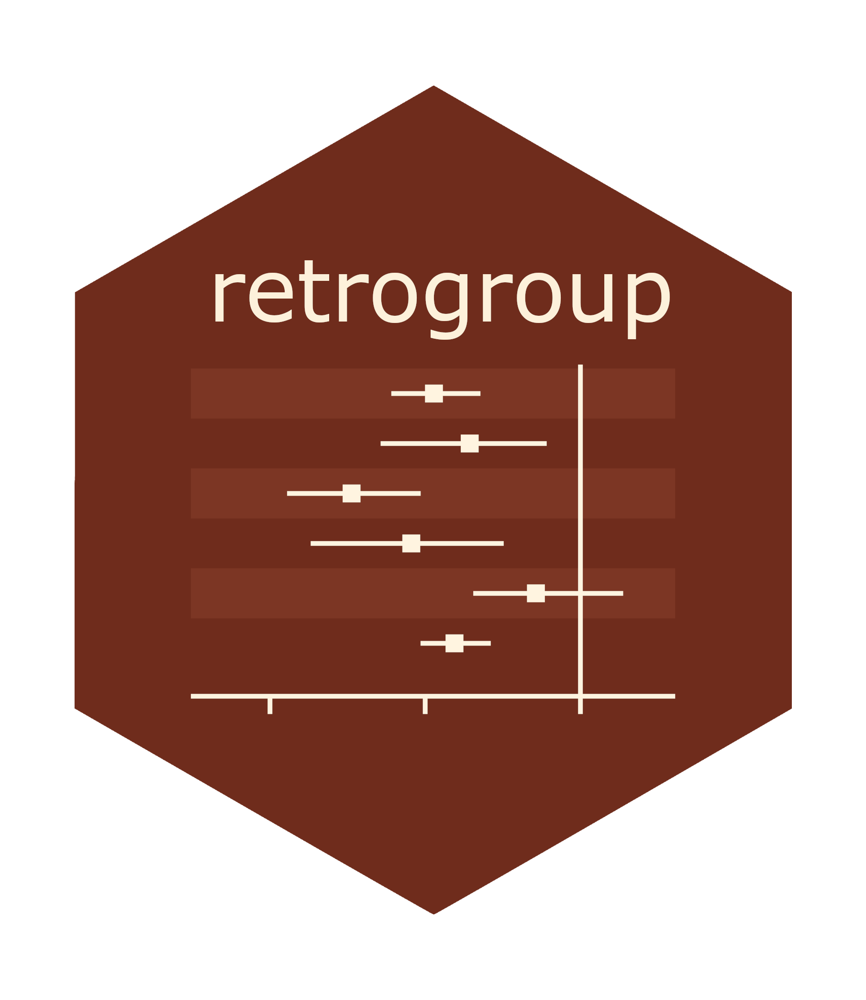

# retrogroup 

Patient-level survival outcomes for a whole clinical trial are frequently available alongside published subgroup hazard ratios, while the subgroup membership of each patient is not.
`retrogroup` reconstructs subgroup membership from these two sources of information.
A Bayesian survival model estimates the posterior probability that each patient belongs to each subgroup level, and a sampling method uses these probabilities to impute a subgroup level for each patient.

## Installation

To install the latest release version of `retrogroup`, open R and run:

``` r
install.packages("pak")
pak::pak("wlandau/retrogroup@*release")
```

To install the development version of `retrogroup`:

``` r
pak::pak("wlandau/retrogroup")
```

## Documentation

The [documentation website](https://wlandau.github.io/retrogroup/) provides a [function reference](https://wlandau.github.io/retrogroup/reference/index.html), usage tutorial, and [vignettes](https://wlandau.github.io/retrogroup/articles/index.html).
The vignettes explain the method and check its performance:

- Methods
  - [The motivating problem](https://wlandau.github.io/retrogroup/articles/framing.html)
  - [The model and posterior](https://wlandau.github.io/retrogroup/articles/model.html)
  - [Sampling subgroups](https://wlandau.github.io/retrogroup/articles/sampling.html)
  - [Optimizing subgroup levels](https://wlandau.github.io/retrogroup/articles/optimization.html)
- Appendix
  - [Approximating event counts](https://wlandau.github.io/retrogroup/articles/events.html)
- Benchmarks
  - [Sampling benchmarks](https://wlandau.github.io/retrogroup/articles/benchmarks_sampling.html)
  - [Optimization benchmarks](https://wlandau.github.io/retrogroup/articles/benchmarks_optimization.html)

## Usage

A typical workflow has four steps: gather the patient-level data and the published subgroup statistics, convert them to the standard format of `retrogroup`, sample subgroup membership for each patient, and optionally optimize the sampled subgroups to match the published statistics.

### Example data

The example below uses the `colon` dataset from the `survival` package, which comes from the adjuvant colon cancer trial of levamisole plus fluorouracil (Moertel et al., 1990).
`group_example_patient()` returns the patient-level survival data, with no subgroup information:

``` r
library(retrogroup)
group_example_patient()
#> # A tibble: 619 × 3
#>    arm      time event
#>    <chr>   <dbl> <int>
#>  1 Lev+5FU  1521     1
#>  2 Lev+5FU  3087     0
#>  3 Obs       963     1
#>  4 Lev+5FU   293     1
#>  5 Obs       659     1
#>  6 Lev+5FU  1767     1
#>  7 Obs      3192     0
#>  8 Lev+5FU  3308     0
#>  9 Lev+5FU  3309     0
#> 10 Obs      2085     1
#> # ℹ 609 more rows
```

`group_example_summary()` returns subgroup statistics like the ones a publication would report.
For each level of age, nodal status, and sex, it gives the number of patients, the number of events, the hazard ratio of treatment versus control, and the 95% confidence interval of the hazard ratio.

``` r
group_example_summary()
#> # A tibble: 6 × 7
#>   variable level      patients events hazard_ratio lower upper
#>   <chr>    <chr>         <int>  <int>        <dbl> <dbl> <dbl>
#> 1 age      under 60        280    129        0.844 0.596 1.20 
#> 2 age      60 or over      339    162        0.579 0.423 0.792
#> 3 node4    no              453    177        0.659 0.489 0.889
#> 4 node4    yes             166    114        0.732 0.505 1.06 
#> 5 sex      female          312    152        0.863 0.628 1.19 
#> 6 sex      male            307    139        0.519 0.365 0.737
```

### Pre-processing

`group_data_patient()` and `group_data_summary()` check the input data for consistency and convert it to the standard format the rest of the package expects.
You supply the column names of your own data and state which study arm is the treatment arm.

``` r
patient <- group_data_patient(
  group_example_patient(),
  arm = "arm",
  treatment = "Lev+5FU",
  time = "time",
  event = "event"
)

summary <- group_data_summary(
  group_example_summary(),
  variable = "variable",
  level = "level",
  patients = "patients",
  events = "events",
  hazard_ratio = "hazard_ratio"
)
```

### Event counts (optional)

Some publications report confidence intervals of the subgroup hazard ratios, but not the subgroup event counts.
In that case, `group_data_events()` can approximate the event counts from the confidence bounds.
First, call `group_data_summary()` with `events = NULL` to skip the event counts.

``` r
summary_no_events <- group_data_summary(
  group_example_summary(),
  variable = "variable",
  level = "level",
  patients = "patients",
  events = NULL,
  hazard_ratio = "hazard_ratio"
)
```

Then pass either the lower or the upper confidence bound of each hazard ratio to `group_data_events()`.
It returns a new summary object with the approximate event counts, adjusted so that they add up to the total number of events in `patient` and do not exceed the number of patients of any level.

``` r
summary_approximate <- group_data_events(
  patient,
  summary_no_events,
  bound = group_example_summary()$upper
)
summary_approximate
#> # A tibble: 6 × 5
#>   variable level      patients events hazard_ratio
#>   <chr>    <chr>         <int>  <int>        <dbl>
#> 1 age      under 60        280    131        0.844
#> 2 age      60 or over      339    160        0.579
#> 3 node4    no              453    176        0.659
#> 4 node4    yes             166    115        0.732
#> 5 sex      female          312    159        0.863
#> 6 sex      male            307    132        0.519
```

The approximate event counts are close to the true counts in `summary`, but they are not exact.
Choosing event counts is a decision about the reconstruction, so please disclose the counts used and how they were chosen.
See [Approximating event counts](https://wlandau.github.io/retrogroup/articles/events.html) for the method.
The rest of this example uses `summary`, which has the true event counts.

### Sampling

`group_sample_unconstrained()` estimates[^1] the posterior probability that each patient belongs to each subgroup level, then samples a subgroup level independently for each patient.
`group_sample_constrained()` is similar, but it ensures that the number of patients and the number of events in each subgroup level exactly match `summary$patients` and `summary$events`.

``` r
set.seed(0)
sample <- group_sample_constrained(patient, summary)
```

``` r
sample
#> # A tibble: 619 × 6
#>    treatment  time event age        node4 sex   
#>        <int> <dbl> <int> <fct>      <fct> <fct> 
#>  1         1  1521     1 60 or over no    male  
#>  2         1  3087     0 under 60   no    female
#>  3         0   963     1 under 60   no    male  
#>  4         1   293     1 60 or over no    male  
#>  5         0   659     1 60 or over yes   male  
#>  6         1  1767     1 under 60   no    male  
#>  7         0  3192     0 60 or over yes   female
#>  8         1  3308     0 60 or over no    female
#>  9         1  3309     0 60 or over no    male  
#> 10         0  2085     1 60 or over no    female
#> # ℹ 609 more rows
```

Each sampled dataset is one random draw, so its subgroup hazard ratios differ somewhat from the published ones.
Across many draws, however, they match the published hazard ratios on average.
The [sampling benchmarks](https://wlandau.github.io/retrogroup/articles/benchmarks_sampling.html) show this for both the colon cancer example and simulated data.

The model has no prognostic effect, so unconstrained sampled subgroup levels are not (on average) associated with the disease’s natural history, and they should not be used for covariate adjustment.
Constrained sampling preserves the number of events in each subgroup level, which carries some general prognostic information.
However, it does not reproduce the timing of events within the subgroup levels of the original data, so some prognostic information is lost.

### Optimization

Optimization refines a single sampled dataset so that its subgroup hazard ratios match the published ones.
`group_optimize_unconstrained()` starts from the output of `group_sample_unconstrained()` and moves one patient at a time to the subgroup level that best reduces the discrepancy.
`group_optimize_constrained()` starts from the output of `group_sample_constrained()` and swaps the subgroup levels of pairs of patients with the same event status, so the numbers of patients and events in each subgroup level never change.

``` r
set.seed(0)
optimized <- group_optimize_constrained(sample, summary)
```

`group_analysis_summary()` computes the subgroup statistics of a patient-level dataset.

``` r
group_analysis_summary(optimized)
#> # A tibble: 6 × 5
#>   variable level      patients events hazard_ratio
#>   <chr>    <chr>         <int>  <int>        <dbl>
#> 1 age      under 60        280    129        0.844
#> 2 age      60 or over      339    162        0.580
#> 3 node4    no              453    177        0.660
#> 4 node4    yes             166    114        0.732
#> 5 sex      female          312    152        0.863
#> 6 sex      male            307    139        0.520
```

The optimized dataset matches the published patient counts, event counts and hazard ratios in `summary`.

``` r
summary
#> # A tibble: 6 × 5
#>   variable level      patients events hazard_ratio
#>   <chr>    <chr>         <int>  <int>        <dbl>
#> 1 age      under 60        280    129        0.844
#> 2 age      60 or over      339    162        0.579
#> 3 node4    no              453    177        0.659
#> 4 node4    yes             166    114        0.732
#> 5 sex      female          312    152        0.863
#> 6 sex      male            307    139        0.519
```

Optimization targets only the hazard ratios of treatment versus control.
Constrained optimization keeps the event counts of constrained sampling, but like constrained sampling, it does not reproduce the timing of events within the subgroup levels of the original data.
A reconstructed dataset is not the original data, and the statistician who uses it in an analysis, for example for covariate adjustment, is responsible for the consequences.

See [Optimizing subgroup levels](https://wlandau.github.io/retrogroup/articles/optimization.html) for the method and the [optimization benchmarks](https://wlandau.github.io/retrogroup/articles/benchmarks_optimization.html) for its performance.

[^1]: via `group_analysis_probability()`
