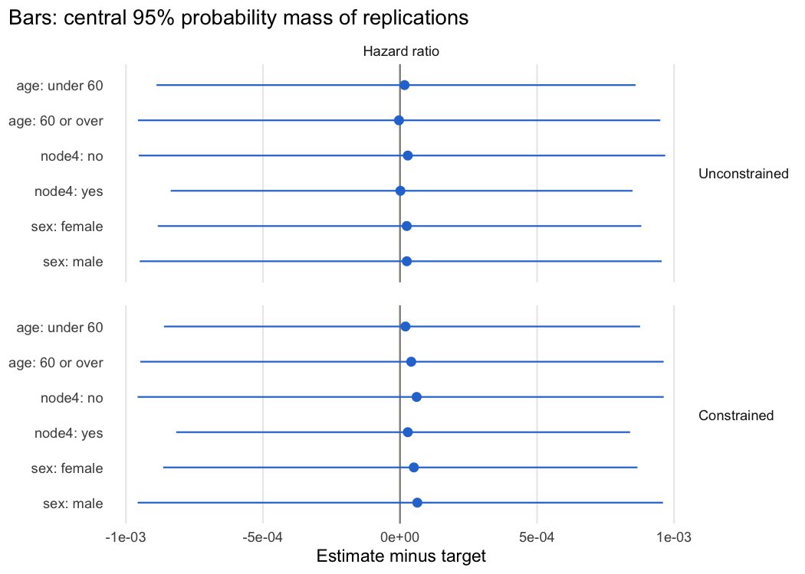
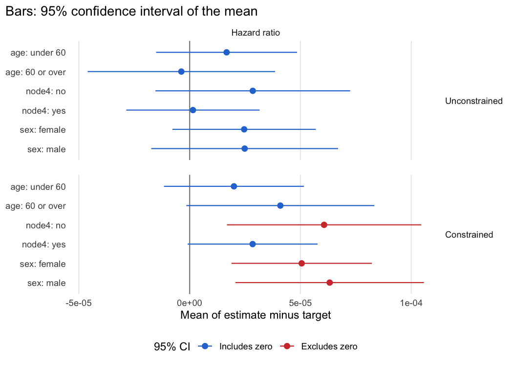
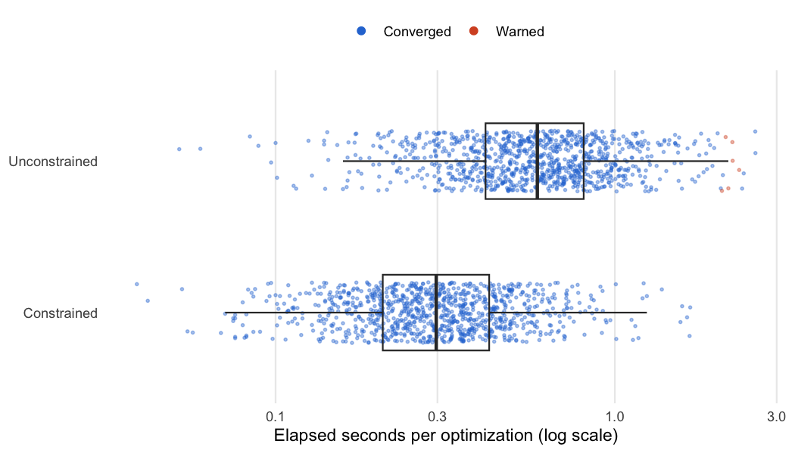

<style>
/* Fit figures to the text column of rmarkdown::html_vignette. */
img {
  box-sizing: border-box;
  max-width: 100%;
  height: auto;
  margin-left: 0;
  margin-right: 0;
}
</style>


``` r
library(retrogroup)
library(ggplot2)
```

<details><summary>Show code</summary>

``` r
reps <- 1000L         # Replications per method. Full scale: 1000L.
iterations <- 10000L  # Maximum iterations per subgroup variable. Full scale: 10000L.
tolerance <- 1e-3     # Stop when the loss falls below this value. Full scale: 1e-3.
```


</details>

Rendered on 2026-11-20 with `retrogroup` 0.0.3 at commit [ded4aa8](https://github.com/wlandau/retrogroup/commit/ded4aa8d389943ccc35799266ead1b2c2fdb5022).

## Purpose

`vignette("optimization", package = "retrogroup")` claims that optimization refines a sampled dataset until its subgroup hazard ratios match the target ones, and that it steers the subgroup event counts toward the target ones.
This vignette tests that claim by simulation for `group_optimize_unconstrained()` and `group_optimize_constrained()`.
For each optimized dataset, it reports:

- how closely the hazard ratios match their targets,
- how long optimization takes, and
- how often optimization stops before the loss falls below the tolerance.

`vignette("benchmarks_sampling", package = "retrogroup")` benchmarks the samplers, so this vignette tests optimization only.

## Method

### Design

A fair test needs targets that the optimizer can attain.
Assumed statistics do not guarantee this: if an optimized dataset misses them, we cannot tell whether the optimizer failed or whether no assignment of subgroups attains them.
So each replication creates its own targets.
It assigns subgroups to the colon cancer patients, computes the summary statistics of that assignment, and uses those statistics as the targets.
That assignment attains the targets exactly, so a solution with zero loss is known to exist.

The patients come from `group_example_patient()`, and the summary statistics that seed each replication come from `group_example_summary()`.
Each replication of each method does the following:

1. **Ground truth.** Draw a sampled dataset from the colon cancer patients and the colon cancer summary statistics with the method's sampler.
   Its subgroups are the ground truth of this replication.
2. **Targets.** Compute the summary statistics of the ground truth dataset with `group_analysis_summary()`, which counts the patients and events and fits the Cox model `survival::coxph(Surv(time, event) ~ treatment)` to the patients in each subgroup level.
   Convert them to the standard format with `group_data_summary()`.
   The hazard ratio of each level is the target, and the numbers of patients and events of each level are the assumed counts.
3. **Starting point.** Discard the ground truth subgroups, and draw a new sampled dataset from the colon cancer patients and the targets with the same sampler.
   The sampler sees the targets but never the ground truth subgroups.
4. **Optimization.** Optimize the starting point toward the targets with the method's optimizer.
5. **Comparison.** Compute the summary statistics of each optimized dataset with `group_analysis_summary()`, and subtract the targets.
   Also record the elapsed time of the optimizer and whether it warned.

For the constrained method, the benchmark also checks the guarantees of `group_sample_constrained()` and `group_optimize_constrained()` in every replication.
The number of patients in each subgroup level must exactly match the colon cancer summary statistics in the ground truth, and it must exactly match the assumed counts of the targets in the starting point and in the optimized dataset.
The number of events is not checked, because optimization only steers it toward the target as a soft constraint.
The benchmark stops with an error if any count differs, so this vignette only renders if every constrained dataset matches.

We test two methods, each with its matching sampler in steps 1 and 3:

1. **Unconstrained.** `group_sample_unconstrained()` and `group_optimize_unconstrained()`.
2. **Constrained.** `group_sample_constrained()` and `group_optimize_constrained()`.

The two optimizers propose different moves, as defined in the "Moves" section of `vignette("optimization", package = "retrogroup")`.
The unconstrained optimizer takes a flip step or a swap step with probability 1/2 each, and the constrained optimizer takes only swap steps.
A flip step fits one Cox model per subgroup level and a swap step fits two, so the moves affect the elapsed time per iteration.

### What the design shows

- **Any mismatch is the optimizer's.** The ground truth subgroups attain the targets exactly, and they come from the same sampler as the starting point. If an optimized dataset misses its targets, the search failed to find a solution that exists.
- **Each dataset is judged individually.** If optimization works, every optimized dataset matches the targets of its own replication, not just on average.

The comparison is between summary statistics only.
Many assignments of subgroups attain the same statistics, so this benchmark does not ask whether optimization recovers the ground truth subgroups of individual patients.

We use only the colon cancer patients, which are real data.
`vignette("benchmarks_sampling", package = "retrogroup")` adds a simulated example to isolate the samplers from misspecification of the model behind `group_analysis_probability()`.
The optimizers fit the Cox model directly and do not use the subgroup probabilities, so a simulated example would add little here.

### Settings

Every optimization uses tolerance = 0.001 and at most 10000 iterations per subgroup variable.
The loss is the Euclidean distance between the optimized and target hazard ratios and event fractions.
Each event fraction is the event count of a subgroup level divided by the target number of patients $n_k$ of that level.
So a loss below this tolerance means that every hazard ratio is within 0.001 of its target, and every event count is within 0.001 $\times n_k$ of its target.

A run stops as soon as its loss falls below the tolerance.
A run whose loss is still above the tolerance after the maximum number of iterations stops there and throws a warning of class `"retrogroup_warning"`.
We count that run as warned.
The elapsed time covers the call to the optimizer only, not sampling or the computation of summary statistics.

Each replication draws its own ground truth, targets, and starting point, so the replications are independent.
The 95% confidence interval of the mean difference is therefore $\bar{d} \pm t_{0.975, R - 1} s / \sqrt{R}$, where $\bar{d}$ and $s$ are the mean and standard deviation of the differences over the $R$ replications.
The intervals are not adjusted for multiple comparisons across subgroup levels and methods.

<details><summary>Show code</summary>

``` r
# constrained = TRUE means every sampled and optimized dataset must
# reproduce the assumed counts of patients.
methods <- list(
  Unconstrained = list(
    sample = group_sample_unconstrained,
    optimize = group_optimize_unconstrained,
    constrained = FALSE
  ),
  Constrained = list(
    sample = group_sample_constrained,
    optimize = group_optimize_constrained,
    constrained = TRUE
  )
)

# Display name and summary statistics column of each quantity we compare.
quantities <- c("Hazard ratio" = "hazard_ratio")

# One label per row of a summary statistics data frame.
subgroup_label <- function(summary) {
  paste0(summary$variable, ": ", summary$level)
}

# Stop unless the number of patients in each
# subgroup level of a dataset equal the assumed counts in summary.
# statistics is the output of group_analysis_summary() for the dataset,
# and name describes the dataset in the error message.
check_counts <- function(statistics, summary, name) {
  statistics <- statistics[
    match(subgroup_label(summary), subgroup_label(statistics)),
  ]
  matches <- identical(statistics$patients, summary$patients)
  if (!matches) {
    stop(
      "The constrained ", name, " does not match the assumed counts.\n",
      "Assumed patients: ", toString(summary$patients), "\n",
      "Observed patients: ", toString(statistics$patients),
      call. = FALSE
    )
  }
}

# Row-bind one named element across a list of results.
collect <- function(results, name) {
  do.call(rbind, lapply(results, `[[`, name))
}

# Call an optimizer. Record its elapsed time in seconds and whether it
# warned that the loss did not fall below the tolerance.
optimize_once <- function(optimize, start, summary) {
  warned <- FALSE
  seconds <- system.time(
    optimized <- withCallingHandlers(
      optimize(start, summary, iterations = iterations, tolerance = tolerance),
      retrogroup_warning = function(condition) {
        warned <<- TRUE
        invokeRestart("muffleWarning")
      }
    )
  )[["elapsed"]]
  list(optimized = optimized, warned = warned, seconds = seconds)
}

# Pair each target with the achieved statistic of the same subgroup level.
# Returns one row per subgroup level and quantity.
compare <- function(targets, achieved) {
  achieved <- achieved[
    match(subgroup_label(targets), subgroup_label(achieved)),
  ]
  rows <- lapply(names(quantities), \(quantity) {
    column <- quantities[[quantity]]
    data.frame(
      subgroup = subgroup_label(targets),
      quantity = quantity,
      target = targets[[column]],
      estimate = achieved[[column]]
    )
  })
  do.call(rbind, rows)
}

# One replication of one method, following steps 1 to 5 of the Design
# section. Returns a list with estimates (one row per subgroup level and
# quantity) and runs (one row).
replication <- function(method, colon) {
  variables <- unique(colon$summary$variable)
  # Step 1: ground truth.
  truth <- method$sample(colon$patient, colon$summary)
  # Step 2: targets.
  truth_statistics <- group_analysis_summary(truth, variables)
  targets <- group_data_summary(
    truth_statistics,
    variable = "variable",
    level = "level",
    patients = "patients",
    events = "events",
    hazard_ratio = "hazard_ratio"
  )
  # Step 3: starting point.
  start <- method$sample(colon$patient, targets)
  # Step 4: optimization.
  run <- optimize_once(method$optimize, start, targets)
  # Step 5: comparison.
  achieved <- group_analysis_summary(run$optimized, variables)
  if (method$constrained) {
    check_counts(truth_statistics, colon$summary, "ground truth")
    check_counts(
      group_analysis_summary(start, variables),
      targets,
      "starting point"
    )
    check_counts(achieved, targets, "optimized dataset")
  }
  list(
    estimates = compare(targets, achieved),
    runs = data.frame(warned = run$warned, seconds = run$seconds)
  )
}

# Summarize the differences (estimate minus target) over replications:
# means, the 2.5% and 97.5% quantiles of the differences, and the 95% t
# confidence interval of the mean difference. Replications are independent,
# so the interval uses all R differences with R - 1 degrees of freedom.
# Returns one row per method, subgroup level, and quantity.
summarize_estimates <- function(estimates) {
  estimates$difference <- estimates$estimate - estimates$target
  out <- stats::aggregate(
    cbind(target, estimate, difference) ~
      subgroup + quantity + method,
    data = estimates,
    FUN = mean
  )
  interval <- stats::aggregate(
    difference ~ subgroup + quantity + method,
    data = estimates,
    FUN = stats::quantile,
    probs = c(0.025, 0.975)
  )
  out$lower <- interval$difference[, 1L]
  out$upper <- interval$difference[, 2L]
  mean_interval <- stats::aggregate(
    difference ~ subgroup + quantity + method,
    data = estimates,
    FUN = \(difference) {
      n <- length(difference)
      half_width <- stats::qt(0.975, df = n - 1L) *
        stats::sd(difference) / sqrt(n)
      mean(difference) + c(-half_width, half_width)
    }
  )
  out$mean_lower <- mean_interval$difference[, 1L]
  out$mean_upper <- mean_interval$difference[, 2L]
  out
}

# Run many replications of every method. Returns a list with estimates
# (the output of summarize_estimates()) and runs (one row per optimization
# run).
benchmark <- function(colon, reps) {
  by_method <- lapply(names(methods), \(name) {
    results <- replicate(
      reps,
      replication(methods[[name]], colon),
      simplify = FALSE
    )
    list(
      estimates = cbind(method = name, collect(results, "estimates")),
      runs = cbind(method = name, collect(results, "runs"))
    )
  })
  estimates <- collect(by_method, "estimates")
  runs <- collect(by_method, "runs")
  # Factor levels fix the order of rows in tables and panels in figures.
  estimates$method <- factor(estimates$method, levels = names(methods))
  estimates$quantity <- factor(estimates$quantity, levels = names(quantities))
  estimates$subgroup <- factor(
    estimates$subgroup,
    levels = subgroup_label(colon$summary)
  )
  runs$method <- factor(runs$method, levels = names(methods))
  list(estimates = summarize_estimates(estimates), runs = runs)
}

# Show 3 decimal places, but switch to scientific notation with 3
# significant figures for nonzero values that would otherwise round to zero.
format_number <- function(x) {
  ifelse(
    x != 0 & round(x, 3L) == 0,
    formatC(x, digits = 2L, format = "e"),
    formatC(x, digits = 3L, format = "f")
  )
}

show_table <- function(x) {
  hr <- x$estimates
  knitr::kable(
    data.frame(
      Method = hr$method,
      Subgroup = hr$subgroup,
      `Mean target HR` = format_number(hr$target),
      `Mean HR` = format_number(hr$estimate),
      `HR difference` = format_number(hr$difference),
      `95% CI of HR difference` = paste0(
        "(", format_number(hr$mean_lower), ", ",
        format_number(hr$mean_upper), ")"
      ),
      check.names = FALSE
    ),
    align = c("l", "l", rep("r", 4L)),
    row.names = FALSE
  )
}

show_plot <- function(x) {
  x <- x$estimates
  ggplot(x, aes(x = difference, xmin = lower, xmax = upper, y = subgroup)) +
    geom_vline(xintercept = 0, color = "#8c8b86") +
    geom_pointrange(color = "#2a78d6", size = 0.4) +
    facet_grid(method ~ quantity, scales = "free_x") +
    scale_y_discrete(limits = rev) +
    labs(
      title = "Bars: central 95% probability mass of replications",
      x = "Estimate minus target",
      y = NULL
    ) +
    theme_minimal(base_size = 11) +
    theme(
      plot.title.position = "plot",
      panel.grid.minor = element_blank(),
      panel.grid.major.y = element_blank(),
      panel.spacing = grid::unit(1, "lines"),
      strip.text.y = element_text(angle = 0, hjust = 0)
    )
}

# Highlight subgroup levels whose confidence interval of the mean excludes 0.
show_mean_plot <- function(x) {
  x <- x$estimates
  x$status <- factor(
    ifelse(
      x$mean_lower > 0 | x$mean_upper < 0,
      "Excludes zero",
      "Includes zero"
    ),
    levels = c("Includes zero", "Excludes zero")
  )
  ggplot(
    x,
    aes(
      x = difference,
      xmin = mean_lower,
      xmax = mean_upper,
      y = subgroup,
      color = status
    )
  ) +
    geom_vline(xintercept = 0, color = "#8c8b86") +
    geom_pointrange(size = 0.4, show.legend = TRUE) +
    facet_grid(method ~ quantity, scales = "free_x") +
    scale_y_discrete(limits = rev) +
    scale_color_manual(
      values = c("Includes zero" = "#2a78d6", "Excludes zero" = "#d03b3b"),
      drop = FALSE
    ) +
    labs(
      title = "Bars: 95% confidence interval of the mean",
      x = "Mean of estimate minus target",
      y = NULL,
      color = "95% CI"
    ) +
    theme_minimal(base_size = 11) +
    theme(
      plot.title.position = "plot",
      panel.grid.minor = element_blank(),
      panel.grid.major.y = element_blank(),
      panel.spacing = grid::unit(1, "lines"),
      legend.position = "bottom",
      strip.text.y = element_text(angle = 0, hjust = 0)
    )
}

show_runs_table <- function(x) {
  seconds <- stats::aggregate(
    seconds ~ method,
    data = x$runs,
    FUN = \(s) c(stats::quantile(s, c(0.5, 0.95)), max(s))
  )
  warned <- stats::aggregate(
    warned ~ method,
    data = x$runs,
    FUN = \(w) c(length(w), mean(w))
  )
  knitr::kable(
    data.frame(
      Method = seconds$method,
      Runs = warned$warned[, 1L],
      `Median seconds` = format_number(seconds$seconds[, 1L]),
      `95th percentile seconds` = format_number(seconds$seconds[, 2L]),
      `Max seconds` = format_number(seconds$seconds[, 3L]),
      `Fraction warned` = format_number(warned$warned[, 2L]),
      check.names = FALSE
    ),
    align = c("l", rep("r", 5L)),
    row.names = FALSE
  )
}

show_runs_plot <- function(x) {
  runs <- x$runs
  runs$warned <- factor(
    ifelse(runs$warned, "Warned", "Converged"),
    levels = c("Converged", "Warned")
  )
  ggplot(runs, aes(x = seconds, y = method)) +
    geom_jitter(
      aes(color = warned),
      height = 0.2,
      width = 0,
      size = 0.6,
      alpha = 0.4,
      show.legend = TRUE
    ) +
    geom_boxplot(fill = NA, outlier.shape = NA, width = 0.5) +
    scale_x_log10() +
    scale_y_discrete(limits = rev) +
    scale_color_manual(
      values = c(Converged = "#2a78d6", Warned = "#d6542a"),
      name = NULL,
      drop = FALSE
    ) +
    guides(color = guide_legend(override.aes = list(size = 2, alpha = 1))) +
    labs(x = "Elapsed seconds per optimization (log scale)", y = NULL) +
    theme_minimal(base_size = 11) +
    theme(
      legend.position = "top",
      panel.grid.minor = element_blank(),
      panel.grid.major.y = element_blank()
    )
}
```


</details>

## Colon cancer example

We run 1000 replications of each method, with one optimization run per replication.


``` r
colon <- list(
  patient = group_data_patient(
    group_example_patient(),
    arm = "arm",
    treatment = "Lev+5FU",
    time = "time",
    event = "event"
  ),
  summary = group_data_summary(
    group_example_summary(),
    variable = "variable",
    level = "level",
    patients = "patients",
    events = "events",
    hazard_ratio = "hazard_ratio"
  )
)

set.seed(1)
colon_results <- benchmark(colon, reps = reps)
```

### Estimates

The targets vary from one replication to the next.
The table reports means over replications of the targets, of the optimized estimates, and of their differences (estimate minus target), and a 95% confidence interval of the mean difference.


|Method        |Subgroup        | Mean target HR| Mean HR| HR difference| 95% CI of HR difference|
|:-------------|:---------------|--------------:|-------:|-------------:|-----------------------:|
|Unconstrained |age: under 60   |          0.851|   0.851|      1.67e-05|   (-1.51e-05, 4.85e-05)|
|Unconstrained |age: 60 or over |          0.576|   0.576|     -3.75e-06|   (-4.60e-05, 3.85e-05)|
|Unconstrained |node4: no       |          0.670|   0.670|      2.85e-05|   (-1.55e-05, 7.24e-05)|
|Unconstrained |node4: yes      |          0.757|   0.757|      1.49e-06|   (-2.86e-05, 3.16e-05)|
|Unconstrained |sex: female     |          0.881|   0.881|      2.46e-05|   (-7.75e-06, 5.69e-05)|
|Unconstrained |sex: male       |          0.523|   0.523|      2.48e-05|   (-1.73e-05, 6.70e-05)|
|Constrained   |age: under 60   |          0.848|   0.848|      2.00e-05|   (-1.16e-05, 5.15e-05)|
|Constrained   |age: 60 or over |          0.577|   0.577|      4.09e-05|   (-1.50e-06, 8.33e-05)|
|Constrained   |node4: no       |          0.670|   0.670|      6.07e-05|    (1.68e-05, 1.04e-04)|
|Constrained   |node4: yes      |          0.757|   0.757|      2.84e-05|   (-9.09e-07, 5.77e-05)|
|Constrained   |sex: female     |          0.874|   0.874|      5.05e-05|    (1.89e-05, 8.22e-05)|
|Constrained   |sex: male       |          0.530|   0.530|      6.32e-05|    (2.07e-05, 1.06e-04)|


The first figure shows the spread of the differences.
Points are means over replications, and bars span the central 95% probability mass of replications.
A narrow bar around zero means that each individual optimized dataset reproduces the targets of its own replication.

<div class="figure">

<p class="caption">Colon cancer example: optimized estimate minus target of the hazard ratio for each subgroup level and method. Points are means over replications, and bars span the central 95% probability mass of replications.</p>
</div>

The second figure shows the precision of the mean.
Points are means over replications, and bars are 95% confidence intervals of the mean difference.
If a confidence interval excludes zero, the mean differs from its target by more than Monte Carlo error can explain, so the optimizer is biased for that subgroup level.

<div class="figure">

<p class="caption">Colon cancer example: mean optimized estimate minus target of the hazard ratio for each subgroup level and method. Points are means over replications, and bars are 95% confidence intervals of the mean. A red interval excludes zero, which means the optimizer is biased for that subgroup level beyond Monte Carlo error.</p>
</div>

### Time and convergence

The table and figure summarize the optimization runs: the elapsed time of each run and the fraction of runs that warned that the loss did not fall below the tolerance.


|Method        | Runs| Median seconds| 95th percentile seconds| Max seconds| Fraction warned|
|:-------------|----:|--------------:|-----------------------:|-----------:|---------------:|
|Unconstrained | 1000|          0.591|                   1.324|       2.597|           0.006|
|Constrained   | 1000|          0.298|                   0.709|       1.668|           0.000|


<div class="figure">

<p class="caption">Colon cancer example: elapsed seconds per optimization run, excluding sampling and summary statistics, for each method. Each point is one run, colored by whether it warned that the loss did not fall below the tolerance.</p>
</div>
