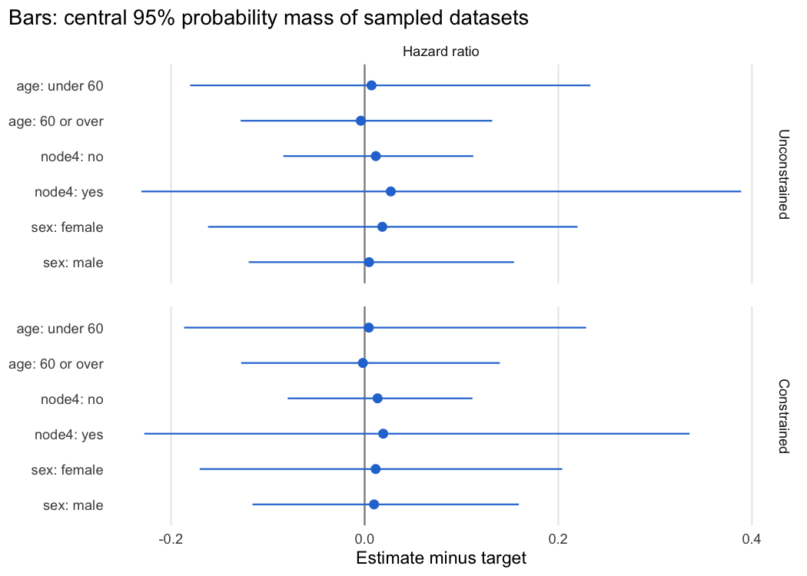
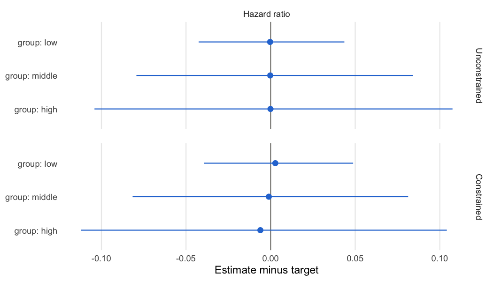

<style>
/* Fit figures to the text column of rmarkdown::html_vignette. */
img {
  box-sizing: border-box;
  max-width: 100%;
  height: auto;
  margin-left: 0;
  margin-right: 0;
}
</style>


``` r
library(retrogroup)
library(ggplot2)
```

<details><summary>Show code</summary>

``` r
colon_reps <- 2000L          # Full scale: 2000 sampled datasets per sampler.
simulated_datasets <- 50L    # Full scale: 50 simulated datasets.
simulated_patients <- 10000L # Full scale: 10000 patients per simulated dataset.
simulated_reps <- 200L       # Full scale: 200 sampled datasets per simulated dataset and sampler.
```


</details>

Rendered on 2026-11-19 with `retrogroup` 0.0.2 at commit [0a22d0a](https://github.com/wlandau/retrogroup/commit/0a22d0a7335a403d6340d3eb3eb4e3bf2aead697).

## Purpose

`vignette("sampling", package = "retrogroup")` claims that sampled datasets reproduce the subgroup log hazard ratios on average.
This vignette checks that claim for `group_sample_unconstrained()` and `group_sample_constrained()`, and it also checks how well the sampled datasets reproduce the standard errors of the log hazard ratios.

## Method

Each benchmark starts from a patient-level dataset whose true subgroups are known.
For each subgroup level, `group_analysis_summary()` fits the Cox model `survival::coxph(Surv(time, event) ~ treatment)` to the patients in that level, and the estimated log hazard ratio is the target for that level.
We then hide the true subgroups and give the sampler only the summary statistics.
The sampler imputes the subgroups, and `group_analysis_summary()` fits the same Cox model to the patients in each imputed level.
Over many sampled datasets, the mean log hazard ratio in each imputed level should match its target.

We run two versions of this experiment:

1. **Colon cancer example.** The 619 patients of `group_example_patient()` with the target log hazard ratios in `group_example_summary()`.
   These are real data, so this example shows how the samplers perform in a realistic setting where the proportional hazards model behind `group_analysis_probability()` may not hold exactly.
2. **Simulated example.** Datasets of 10000 patients each, with one subgroup variable of three levels, log hazard ratios $(-0.8, 0, 0.5)$, and prevalences $(0.3, 0.3, 0.4)$.
   The data-generating model agrees with the model that `group_analysis_probability()` uses for the subgroup probabilities, so this example shows how the samplers perform when that model is correct.
   Any remaining difference from the targets is due to the samplers, not to model misspecification.

Each experiment reports a table of targets, means over the sampled datasets, and their differences (mean minus target).
Each figure shows the difference between a sampled dataset's estimate and its target: points are means, and bars span the central 95% of sampled datasets.

<details><summary>Show code</summary>

``` r
samplers <- list(
  Unconstrained = group_sample_unconstrained,
  Constrained = group_sample_constrained
)

quantities <- c(
  "Log hazard ratio" = "log_hazard_ratio",
  "Standard error" = "standard_error"
)

# Estimates from repeated calls to one sampler on one dataset:
# one row per sampled dataset, subgroup level, and quantity.
sample_estimates <- function(sampler, data, reps) {
  summary <- data$summary
  variables <- unique(summary$variable)
  key <- paste(summary$variable, summary$level)
  # Array of estimates: subgroup level x quantity x sampled dataset.
  fits <- replicate(reps, {
    sample <- sampler(data$patient, summary)
    estimates <- group_analysis_summary(sample, variables)
    rows <- match(key, paste(estimates$variable, estimates$level))
    as.matrix(estimates[rows, quantities])
  })
  subgroup <- paste0(summary$variable, ": ", summary$level)
  rows <- lapply(names(quantities), \(quantity) {
    data.frame(
      subgroup = factor(subgroup, levels = subgroup),
      quantity = factor(quantity, levels = names(quantities)),
      target = summary[[quantities[[quantity]]]],
      estimate = c(fits[, quantities[[quantity]], ])
    )
  })
  do.call(rbind, rows)
}

# Benchmark every sampler on the same list of datasets.
# Returns one row per sampler, subgroup level, and quantity.
benchmark <- function(datasets, reps) {
  estimates <- lapply(names(samplers), \(name) {
    estimates <- lapply(
      datasets,
      \(data) sample_estimates(samplers[[name]], data, reps)
    )
    cbind(
      sampler = factor(name, levels = names(samplers)),
      do.call(rbind, estimates)
    )
  })
  estimates <- do.call(rbind, estimates)
  estimates$difference <- estimates$estimate - estimates$target
  out <- stats::aggregate(
    cbind(target, estimate, difference) ~ subgroup + quantity + sampler,
    data = estimates,
    FUN = mean
  )
  interval <- stats::aggregate(
    difference ~ subgroup + quantity + sampler,
    data = estimates,
    FUN = stats::quantile,
    probs = c(0.025, 0.975)
  )
  out$lower <- interval$difference[, 1L]
  out$upper <- interval$difference[, 2L]
  out
}

simulate_dataset <- function(n) {
  beta <- c(-0.8, 0, 0.5)
  levels <- c("low", "middle", "high")
  treatment <- stats::rbinom(n, 1L, 0.5)
  x <- sample.int(3L, n, replace = TRUE, prob = c(0.3, 0.3, 0.4))
  event_time <- stats::rexp(n, 0.1 * exp(beta[x] * treatment))
  censor_time <- stats::runif(n, 0, 20)
  patient <- tibble::tibble(
    treatment = treatment,
    time = pmin(event_time, censor_time),
    event = as.integer(event_time <= censor_time),
    group = factor(levels[x], levels = levels)
  )
  summary <- group_analysis_summary(patient, "group")
  patient$group <- NULL
  list(patient = patient, summary = summary)
}

# Show 3 decimal places, but use 3 significant figures for nonzero values
# that would otherwise round to zero, in scientific notation.
format_number <- function(x) {
  ifelse(
    x != 0 & round(x, 3L) == 0,
    formatC(x, digits = 2L, format = "e"),
    formatC(x, digits = 3L, format = "f")
  )
}

show_table <- function(x) {
  hr <- x[x$quantity == "Log hazard ratio", ]
  se <- x[x$quantity == "Standard error", ]
  knitr::kable(
    data.frame(
      Sampler = hr$sampler,
      Subgroup = hr$subgroup,
      `Target log HR` = format_number(hr$target),
      `Mean log HR` = format_number(hr$estimate),
      `Log HR difference` = format_number(hr$difference),
      `Target SE` = format_number(se$target),
      `Mean SE` = format_number(se$estimate),
      `SE difference` = format_number(se$difference),
      check.names = FALSE
    ),
    align = c("l", "l", rep("r", 6L)),
    row.names = FALSE
  )
}

show_plot <- function(x) {
  ggplot(x, aes(x = difference, xmin = lower, xmax = upper, y = subgroup)) +
    geom_vline(xintercept = 0, color = "#8c8b86") +
    geom_pointrange(color = "#2a78d6", size = 0.4) +
    facet_grid(sampler ~ quantity, scales = "free_x") +
    scale_y_discrete(limits = rev) +
    labs(x = "Estimate minus target", y = NULL) +
    theme_minimal(base_size = 11) +
    theme(
      panel.grid.minor = element_blank(),
      panel.grid.major.y = element_blank(),
      panel.spacing = grid::unit(1, "lines")
    )
}
```


</details>

## Colon cancer example

We draw 2000 sampled datasets with each sampler.


``` r
colon <- list(
  patient = group_data_patient(
    group_example_patient(),
    arm = "arm",
    treatment = "Lev+5FU",
    time = "time",
    event = "event"
  ),
  summary = group_data_summary(
    group_example_summary(),
    variable = "variable",
    level = "level",
    patients = "patients",
    log_hazard_ratio = "log_hazard_ratio",
    standard_error = "standard_error"
  )
)

set.seed(1)
colon_results <- benchmark(list(colon), reps = colon_reps)
```


|Sampler       |Subgroup        | Target log HR| Mean log HR| Log HR difference| Target SE| Mean SE| SE difference|
|:-------------|:---------------|-------------:|-----------:|-----------------:|---------:|-------:|-------------:|
|Unconstrained |age: under 60   |        -0.169|      -0.169|             0.001|     0.178|   0.170|        -0.008|
|Unconstrained |age: 60 or over |        -0.546|      -0.560|            -0.014|     0.160|   0.168|         0.008|
|Unconstrained |node4: no       |        -0.417|      -0.402|             0.015|     0.153|   0.140|        -0.013|
|Unconstrained |node4: yes      |        -0.312|      -0.296|             0.016|     0.190|   0.228|         0.038|
|Unconstrained |sex: female     |        -0.147|      -0.133|             0.015|     0.162|   0.159|        -0.003|
|Unconstrained |sex: male       |        -0.656|      -0.656|         -8.33e-05|     0.179|   0.181|         0.003|
|Constrained   |age: under 60   |        -0.169|      -0.172|            -0.003|     0.178|   0.170|        -0.008|
|Constrained   |age: 60 or over |        -0.546|      -0.556|            -0.010|     0.160|   0.168|         0.008|
|Constrained   |node4: no       |        -0.417|      -0.399|             0.017|     0.153|   0.140|        -0.013|
|Constrained   |node4: yes      |        -0.312|      -0.305|             0.008|     0.190|   0.228|         0.038|
|Constrained   |sex: female     |        -0.147|      -0.140|             0.007|     0.162|   0.160|        -0.003|
|Constrained   |sex: male       |        -0.656|      -0.646|             0.010|     0.179|   0.181|         0.002|


<div class="figure">

<p class="caption">Colon cancer example: estimate minus target for each subgroup level, quantity, and sampler. Points are means over the sampled datasets, and bars span quantile intervals of the sampled datasets. A point on the vertical line at zero means the sampled datasets reproduce the target on average.</p>
</div>

## Simulated example

We simulate 50 datasets and draw 200 sampled datasets from each with each sampler.
Each estimate is compared with the target of the simulated dataset it was sampled from, and the results pool all simulated datasets.


``` r
set.seed(2)
simulated <- replicate(
  simulated_datasets,
  simulate_dataset(simulated_patients),
  simplify = FALSE
)
simulated_results <- benchmark(simulated, reps = simulated_reps)
```


|Sampler       |Subgroup      | Target log HR| Mean log HR| Log HR difference| Target SE| Mean SE| SE difference|
|:-------------|:-------------|-------------:|-----------:|-----------------:|---------:|-------:|-------------:|
|Unconstrained |group: low    |        -0.805|      -0.806|         -4.71e-04|     0.057|   0.057|     -4.02e-06|
|Unconstrained |group: middle |        -0.003|      -0.002|             0.001|     0.049|   0.049|     -1.71e-05|
|Unconstrained |group: high   |         0.497|       0.499|             0.001|     0.040|   0.040|      3.96e-05|
|Constrained   |group: low    |        -0.805|      -0.799|             0.007|     0.057|   0.056|     -9.40e-05|
|Constrained   |group: middle |        -0.003|      -0.003|          6.27e-05|     0.049|   0.049|     -2.11e-05|
|Constrained   |group: high   |         0.497|       0.494|            -0.003|     0.040|   0.040|      4.62e-05|


<div class="figure">

<p class="caption">Simulated example: estimate minus target for each subgroup level, quantity, and sampler, pooled over all simulated datasets. Points are means over the sampled datasets, and bars span quantile intervals of the sampled datasets. A point on the vertical line at zero means the sampled datasets reproduce the target on average.</p>
</div>
