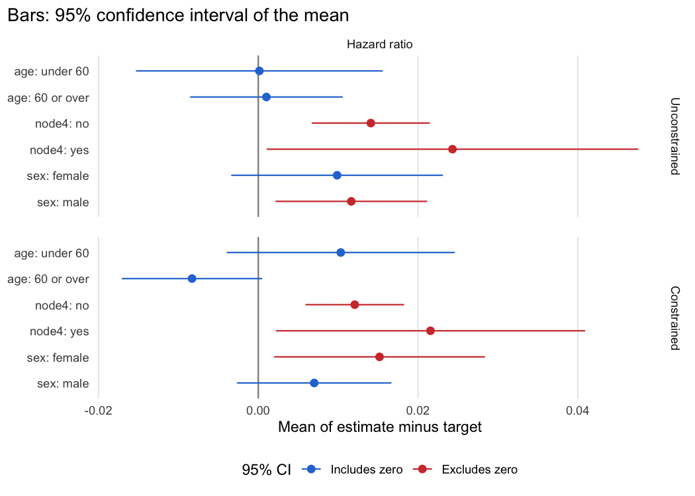
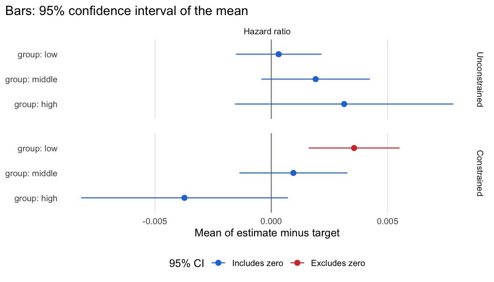

<style>
/* Fit figures to the text column of rmarkdown::html_vignette. */
img {
  box-sizing: border-box;
  max-width: 100%;
  height: auto;
  margin-left: 0;
  margin-right: 0;
}
</style>


``` r
library(retrogroup)
library(ggplot2)
```

<details><summary>Show code</summary>

``` r
colon_reps <- 200L          # Full scale: 2000 sampled datasets per sampler.
simulated_datasets <- 50L    # Full scale: 50 simulated datasets.
simulated_patients <- 10000L # Full scale: 10000 patients per simulated dataset.
simulated_reps <- 200L       # Full scale: 200 sampled datasets per simulated dataset and sampler.
```


</details>

Rendered on 2026-11-20 with `retrogroup` 0.0.3 at commit [ded4aa8](https://github.com/wlandau/retrogroup/commit/ded4aa8d389943ccc35799266ead1b2c2fdb5022).

## Purpose

`vignette("sampling", package = "retrogroup")` claims that sampled datasets reproduce the subgroup hazard ratios on average.
This vignette checks that claim for `group_sample_unconstrained()` and `group_sample_constrained()`.

## Method

Each benchmark starts from a patient-level dataset whose true subgroups are known.
For each subgroup level, `group_analysis_summary()` fits the Cox model `survival::coxph(Surv(time, event) ~ treatment)` to the patients in that level, and the estimated hazard ratio is the target for that level.
We then hide the true subgroups and give the sampler only the summary statistics.
The sampler imputes the subgroups, and `group_analysis_summary()` fits the same Cox model to the patients in each imputed level.
Over many sampled datasets, the mean hazard ratio in each imputed level should match its target.

We run two versions of this experiment:

1. **Colon cancer example.** The 619 patients of `group_example_patient()` with the target hazard ratios in `group_example_summary()`.
   These are real data, so this example shows how the samplers perform in a realistic setting where the proportional hazards model behind `group_analysis_probability()` may not hold exactly.
2. **Simulated example.** Datasets of 10000 patients each, with one subgroup variable of three levels, hazard ratios $(e^{-0.8}, 1, e^{0.5}) \approx (0.449, 1, 1.649)$, and prevalences $(0.3, 0.3, 0.4)$.
   The data-generating model agrees with the model that `group_analysis_probability()` uses for the subgroup probabilities, so this example shows how the samplers perform when that model is correct.
   Any remaining difference from the targets is due to the samplers, not to model misspecification.

`group_sample_constrained()` promises that the number of patients in each subgroup level of every sampled dataset exactly matches the assumed counts in the summary.
The benchmark checks this promise for every constrained sampled dataset, and it stops with an error if any count differs, so this vignette only renders if every constrained sampled dataset matches.

Each experiment reports a table of targets, means over the sampled datasets, their differences (mean minus target), and a 95% confidence interval of the mean difference.
The first figure of each experiment shows the spread of sampled datasets: points are mean differences, and bars span the central 95% of the differences between a sampled dataset's estimate and its target.
The second figure shows the precision of the mean: points are mean differences, and bars are 95% confidence intervals of the mean difference.
If a confidence interval excludes zero, the mean differs from its target by more than Monte Carlo error can explain, so the sampler is biased for that subgroup level.

In the colon cancer example, the sampled datasets are independent draws from the same patient-level data, so the confidence interval is $\bar{d} \pm t_{0.975, R - 1} s / \sqrt{R}$, where $\bar{d}$ and $s$ are the mean and standard deviation of the $R$ differences.
In the simulated example, sampled datasets from the same simulated dataset share its patients, so they are correlated.
The simulated datasets are independent, so the confidence interval uses the same formula on the $D$ per-dataset mean differences instead, with $D - 1$ degrees of freedom.
The intervals are not adjusted for multiple comparisons across subgroup levels and samplers.

<details><summary>Show code</summary>

``` r
samplers <- list(
  Unconstrained = group_sample_unconstrained,
  Constrained = group_sample_constrained
)

# Samplers that must reproduce the assumed counts of patients.
constrained <- c(Unconstrained = FALSE, Constrained = TRUE)

quantities <- c("Hazard ratio" = "hazard_ratio")

# Stop unless the number of patients in each
# subgroup level of a sampled dataset equal the assumed counts in summary.
# estimates has the rows of group_analysis_summary() in the order of summary,
# with rows of NA for subgroup levels that have no patients.
check_counts <- function(estimates, summary) {
  matches <- identical(estimates$patients, summary$patients)
  if (!matches) {
    stop(
      "A constrained sampled dataset does not match the assumed counts.\n",
      "Assumed patients: ", toString(summary$patients), "\n",
      "Sampled patients: ", toString(estimates$patients),
      call. = FALSE
    )
  }
}

# Estimates from repeated calls to one sampler on one dataset:
# one row per sampled dataset, subgroup level, and quantity.
# If constrained is TRUE, every sampled dataset must match the assumed counts.
sample_estimates <- function(sampler, data, reps, constrained) {
  summary <- data$summary
  variables <- unique(summary$variable)
  key <- paste(summary$variable, summary$level)
  # Array of estimates: subgroup level x quantity x sampled dataset.
  fits <- replicate(reps, {
    sample <- sampler(data$patient, summary)
    estimates <- group_analysis_summary(sample, variables)
    rows <- match(key, paste(estimates$variable, estimates$level))
    if (constrained) {
      check_counts(estimates[rows, ], summary)
    }
    as.matrix(estimates[rows, quantities, drop = FALSE])
  })
  subgroup <- paste0(summary$variable, ": ", summary$level)
  rows <- lapply(names(quantities), \(quantity) {
    data.frame(
      subgroup = factor(subgroup, levels = subgroup),
      quantity = factor(quantity, levels = names(quantities)),
      target = summary[[quantities[[quantity]]]],
      estimate = c(fits[, quantities[[quantity]], ])
    )
  })
  do.call(rbind, rows)
}

# Benchmark every sampler on the same list of datasets.
# Returns one row per sampler, subgroup level, and quantity.
benchmark <- function(datasets, reps) {
  estimates <- lapply(names(samplers), \(name) {
    estimates <- lapply(seq_along(datasets), \(dataset) {
      cbind(
        dataset = dataset,
        sample_estimates(
          samplers[[name]],
          datasets[[dataset]],
          reps,
          constrained[[name]]
        )
      )
    })
    cbind(
      sampler = factor(name, levels = names(samplers)),
      do.call(rbind, estimates)
    )
  })
  estimates <- do.call(rbind, estimates)
  estimates$difference <- estimates$estimate - estimates$target
  out <- stats::aggregate(
    cbind(target, estimate, difference) ~ subgroup + quantity + sampler,
    data = estimates,
    FUN = mean
  )
  interval <- stats::aggregate(
    difference ~ subgroup + quantity + sampler,
    data = estimates,
    FUN = stats::quantile,
    probs = c(0.025, 0.975)
  )
  out$lower <- interval$difference[, 1L]
  out$upper <- interval$difference[, 2L]
  mean_intervals <- vapply(seq_len(nrow(out)), \(row) {
    rows <- estimates$subgroup == out$subgroup[row] &
      estimates$quantity == out$quantity[row] &
      estimates$sampler == out$sampler[row]
    mean_interval(estimates$difference[rows], estimates$dataset[rows])
  }, numeric(2L))
  out$mean_lower <- mean_intervals[1L, ]
  out$mean_upper <- mean_intervals[2L, ]
  out
}

# 95% t confidence interval of the mean difference.
# With one dataset, the sampled datasets are independent draws.
# With several datasets, sampled datasets from the same dataset are
# correlated, so the interval uses the independent per-dataset means.
mean_interval <- function(difference, dataset) {
  units <- if (length(unique(dataset)) > 1L) {
    tapply(difference, dataset, mean)
  } else {
    difference
  }
  n <- length(units)
  half_width <- stats::qt(0.975, df = n - 1L) * stats::sd(units) / sqrt(n)
  mean(units) + c(-half_width, half_width)
}

simulate_dataset <- function(n) {
  beta <- c(-0.8, 0, 0.5)
  levels <- c("low", "middle", "high")
  treatment <- stats::rbinom(n, 1L, 0.5)
  x <- sample.int(3L, n, replace = TRUE, prob = c(0.3, 0.3, 0.4))
  event_time <- stats::rexp(n, 0.1 * exp(beta[x] * treatment))
  censor_time <- stats::runif(n, 0, 20)
  data <- tibble::tibble(
    arm = ifelse(treatment == 1L, "treatment", "control"),
    time = pmin(event_time, censor_time),
    event = as.integer(event_time <= censor_time)
  )
  patient <- group_data_patient(
    data,
    arm = "arm",
    treatment = "treatment",
    time = "time",
    event = "event"
  )
  # The true subgroups give the assumed subgroup statistics, then the
  # sampler only sees patient (without the subgroups) and summary.
  truth <- patient
  truth$group <- factor(levels[x], levels = levels)
  summary <- group_data_summary(
    group_analysis_summary(truth, "group"),
    variable = "variable",
    level = "level",
    patients = "patients",
    events = "events",
    hazard_ratio = "hazard_ratio"
  )
  list(patient = patient, summary = summary)
}

# Show 3 decimal places, but use 3 significant figures for nonzero values
# that would otherwise round to zero, in scientific notation.
format_number <- function(x) {
  ifelse(
    x != 0 & round(x, 3L) == 0,
    formatC(x, digits = 2L, format = "e"),
    formatC(x, digits = 3L, format = "f")
  )
}

show_table <- function(x) {
  hr <- x[x$quantity == "Hazard ratio", ]
  knitr::kable(
    data.frame(
      Sampler = hr$sampler,
      Subgroup = hr$subgroup,
      `Target HR` = format_number(hr$target),
      `Mean HR` = format_number(hr$estimate),
      `HR difference` = format_number(hr$difference),
      `95% CI of HR difference` = paste0(
        "(", format_number(hr$mean_lower), ", ",
        format_number(hr$mean_upper), ")"
      ),
      check.names = FALSE
    ),
    align = c("l", "l", rep("r", 4L)),
    row.names = FALSE
  )
}

show_plot <- function(x) {
  ggplot(x, aes(x = difference, xmin = lower, xmax = upper, y = subgroup)) +
    geom_vline(xintercept = 0, color = "#8c8b86") +
    geom_pointrange(color = "#2a78d6", size = 0.4) +
    facet_grid(sampler ~ quantity, scales = "free_x") +
    scale_y_discrete(limits = rev) +
    labs(
      title = "Bars: central 95% probability mass of sampled datasets",
      x = "Estimate minus target",
      y = NULL
    ) +
    theme_minimal(base_size = 11) +
    theme(
      plot.title.position = "plot",
      panel.grid.minor = element_blank(),
      panel.grid.major.y = element_blank(),
      panel.spacing = grid::unit(1, "lines")
    )
}

# Highlight subgroup levels whose confidence interval of the mean excludes 0.
show_mean_plot <- function(x) {
  x$status <- factor(
    ifelse(
      x$mean_lower > 0 | x$mean_upper < 0,
      "Excludes zero",
      "Includes zero"
    ),
    levels = c("Includes zero", "Excludes zero")
  )
  ggplot(
    x,
    aes(
      x = difference,
      xmin = mean_lower,
      xmax = mean_upper,
      y = subgroup,
      color = status
    )
  ) +
    geom_vline(xintercept = 0, color = "#8c8b86") +
    geom_pointrange(size = 0.4, show.legend = TRUE) +
    facet_grid(sampler ~ quantity, scales = "free_x") +
    scale_y_discrete(limits = rev) +
    scale_color_manual(
      values = c("Includes zero" = "#2a78d6", "Excludes zero" = "#d03b3b"),
      drop = FALSE
    ) +
    labs(
      title = "Bars: 95% confidence interval of the mean",
      x = "Mean of estimate minus target",
      y = NULL,
      color = "95% CI"
    ) +
    theme_minimal(base_size = 11) +
    theme(
      plot.title.position = "plot",
      panel.grid.minor = element_blank(),
      panel.grid.major.y = element_blank(),
      panel.spacing = grid::unit(1, "lines"),
      legend.position = "bottom"
    )
}
```


</details>

## Colon cancer example

We draw 200 sampled datasets with each sampler.


``` r
colon <- list(
  patient = group_data_patient(
    group_example_patient(),
    arm = "arm",
    treatment = "Lev+5FU",
    time = "time",
    event = "event"
  ),
  summary = group_data_summary(
    group_example_summary(),
    variable = "variable",
    level = "level",
    patients = "patients",
    events = "events",
    hazard_ratio = "hazard_ratio"
  )
)

set.seed(1)
colon_results <- benchmark(list(colon), reps = colon_reps)
```


|Sampler       |Subgroup        | Target HR| Mean HR| HR difference| 95% CI of HR difference|
|:-------------|:---------------|---------:|-------:|-------------:|-----------------------:|
|Unconstrained |age: under 60   |     0.844|   0.844|      1.37e-04|         (-0.015, 0.016)|
|Unconstrained |age: 60 or over |     0.579|   0.580|         0.001|         (-0.009, 0.011)|
|Unconstrained |node4: no       |     0.659|   0.673|         0.014|          (0.007, 0.021)|
|Unconstrained |node4: yes      |     0.732|   0.756|         0.024|          (0.001, 0.048)|
|Unconstrained |sex: female     |     0.863|   0.873|         0.010|         (-0.003, 0.023)|
|Unconstrained |sex: male       |     0.519|   0.531|         0.012|          (0.002, 0.021)|
|Constrained   |age: under 60   |     0.844|   0.855|         0.010|         (-0.004, 0.025)|
|Constrained   |age: 60 or over |     0.579|   0.571|        -0.008|      (-0.017, 4.93e-04)|
|Constrained   |node4: no       |     0.659|   0.671|         0.012|          (0.006, 0.018)|
|Constrained   |node4: yes      |     0.732|   0.753|         0.022|          (0.002, 0.041)|
|Constrained   |sex: female     |     0.863|   0.878|         0.015|          (0.002, 0.028)|
|Constrained   |sex: male       |     0.519|   0.526|         0.007|         (-0.003, 0.017)|


<div class="figure">

<p class="caption">Colon cancer example: estimate minus target of the hazard ratio for each subgroup level and sampler. Points are means over the sampled datasets, and bars span the central 95% probability mass of the sampled datasets. A point on the vertical line at zero means the sampled datasets reproduce the target on average.</p>
</div>

<div class="figure">

<p class="caption">Colon cancer example: mean estimate minus target of the hazard ratio for each subgroup level and sampler. Points are means over the sampled datasets, and bars are 95% confidence intervals of the mean. A red interval excludes zero, which means the sampler is biased for that subgroup level beyond Monte Carlo error.</p>
</div>

## Simulated example

We simulate 50 datasets and draw 200 sampled datasets from each with each sampler.
Each estimate is compared with the target of the simulated dataset it was sampled from, and the results pool all simulated datasets.


``` r
set.seed(2)
simulated <- replicate(
  simulated_datasets,
  simulate_dataset(simulated_patients),
  simplify = FALSE
)
simulated_results <- benchmark(simulated, reps = simulated_reps)
```


|Sampler       |Subgroup      | Target HR| Mean HR| HR difference| 95% CI of HR difference|
|:-------------|:-------------|---------:|-------:|-------------:|-----------------------:|
|Unconstrained |group: low    |     0.448|   0.448|      3.16e-04|         (-0.002, 0.002)|
|Unconstrained |group: middle |     0.998|   1.000|         0.002|      (-4.25e-04, 0.004)|
|Unconstrained |group: high   |     1.646|   1.649|         0.003|         (-0.002, 0.008)|
|Constrained   |group: low    |     0.448|   0.451|         0.004|          (0.002, 0.006)|
|Constrained   |group: middle |     0.998|   0.999|         0.001|         (-0.001, 0.003)|
|Constrained   |group: high   |     1.646|   1.642|        -0.004|         (-0.008, 0.001)|


<div class="figure">

<p class="caption">Simulated example: estimate minus target of the hazard ratio for each subgroup level and sampler, pooled over all simulated datasets. Points are means over the sampled datasets, and bars span the central 95% probability mass of the sampled datasets. A point on the vertical line at zero means the sampled datasets reproduce the target on average.</p>
</div>

<div class="figure">

<p class="caption">Simulated example: mean estimate minus target of the hazard ratio for each subgroup level and sampler, pooled over all simulated datasets. Points are means over the sampled datasets, and bars are 95% confidence intervals of the mean computed from the per-dataset means. A red interval excludes zero, which means the sampler is biased for that subgroup level beyond Monte Carlo error.</p>
</div>
