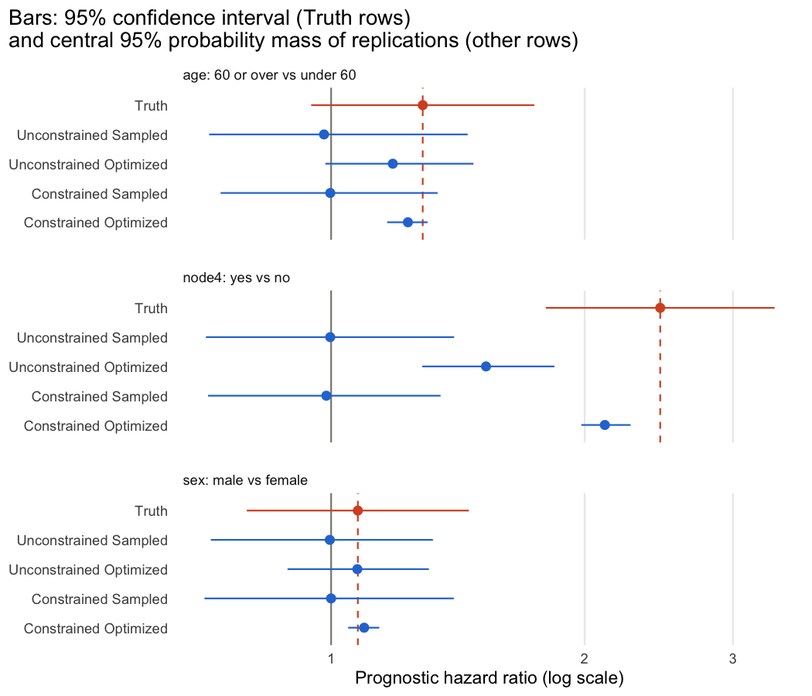

<style>
/* Fit figures to the text column of rmarkdown::html_vignette. */
img {
  box-sizing: border-box;
  max-width: 100%;
  height: auto;
  margin-left: 0;
  margin-right: 0;
}
</style>


``` r
library(retrogroup)
library(ggplot2)
```

<details><summary>Show code</summary>

``` r
reps <- 100L         # Replications per method. Full scale: 1000L.
iterations <- 10000L  # Maximum iterations per subgroup variable. Full scale: 10000L.
tolerance <- 1e-3     # Stop when the loss falls below this value. Full scale: 1e-3.
```


</details>

Rendered on 2026-11-20 with `retrogroup` 0.0.3 at commit [ded4aa8](https://github.com/wlandau/retrogroup/commit/ded4aa8d389943ccc35799266ead1b2c2fdb5022).

## Purpose

`vignette("sampling", package = "retrogroup")` claims that sampled subgroups carry no prognostic information, whether sampling is unconstrained or constrained.
`vignette("optimization", package = "retrogroup")` makes no claims about the prognostic information of optimized subgroups, but its loss function steers the event count of each subgroup level toward its assumed value.
This vignette examines both questions by simulation.
It asks how well the subgroups of sampled and optimized datasets recover the prognostic hazard ratios of the true subgroups.

## Method

### Model

For each subgroup variable, we fit the Cox model

```r
survival::coxph(Surv(time, event) ~ treatment * level, ties = "efron")
```

where `level` is the subgroup variable, and its reference level is the first level in the summary statistics.
The model has a treatment effect, a subgroup effect, and a treatment by subgroup interaction.
The prognostic hazard ratio of a non-reference level is the exponential of its main effect coefficient: the hazard of that level relative to the reference level in the control arm.
We report each prognostic hazard ratio with its 95% Wald confidence interval.

### Design

The colon cancer patients of `group_example_patient()` come from `survival::colon`, so their true subgroups are known.
We fit the model to the true subgroups once, and the resulting prognostic hazard ratios and confidence intervals are the truth.

Each replication of each method then does the following:

1. **Hide the subgroups.** Keep only the patient-level survival data and the summary statistics of `group_example_summary()`.
2. **Sampling.** Draw a sampled dataset with the method's sampler.
3. **Optimization.** Optimize the sampled dataset toward the summary statistics with the method's optimizer.
   Record whether the optimizer warned that the loss did not fall below the tolerance.
4. **Comparison.** Fit the model to the sampled dataset and to the optimized dataset, and record the prognostic hazard ratios and their confidence intervals.

We test two methods:

1. **Unconstrained.** `group_sample_unconstrained()` and `group_optimize_unconstrained()`.
2. **Constrained.** `group_sample_constrained()` and `group_optimize_constrained()`.

### What to expect

The model in `vignette("model", package = "retrogroup")` has no prognostic effect, so sampled subgroups from either sampler should have prognostic hazard ratios near 1.
Optimization steers the event count of each subgroup level toward its assumed value, which may move the prognostic hazard ratios of optimized subgroups toward the truth.
However, optimization does not reproduce the timing of events within each level, so we make no prediction about how much, if any, prognostic information it recovers.

Every optimization uses tolerance = 0.001 and at most 10000 iterations per subgroup variable.

<details><summary>Show code</summary>

``` r
methods <- list(
  Unconstrained = list(
    sample = group_sample_unconstrained,
    optimize = group_optimize_unconstrained
  ),
  Constrained = list(
    sample = group_sample_constrained,
    optimize = group_optimize_constrained
  )
)

stages <- c("Sampled", "Optimized")

# Row-bind one named element across a list of results.
collect <- function(results, name) {
  do.call(rbind, lapply(results, `[[`, name))
}

# Prognostic hazard ratios of one subgroup variable: the exponentials of
# the main effect coefficients of the subgroup in the Cox model
# Surv(time, event) ~ treatment * level, with 95% Wald confidence
# intervals. levels are the levels of the subgroup variable, and the first
# is the reference. Returns one row per non-reference level, with NA if
# the model cannot be fit.
prognostic_fit <- function(data, variable, levels) {
  data$level <- factor(as.character(data[[variable]]), levels = levels)
  names <- paste0("level", levels[-1L])
  bounds <- tryCatch(
    {
      fit <- survival::coxph(
        survival::Surv(time, event) ~ treatment * level,
        data = data,
        ties = "efron"
      )
      cbind(stats::coef(fit), stats::confint(fit))[names, , drop = FALSE]
    },
    error = \(error) matrix(NA_real_, length(names), 3L),
    warning = \(warning) matrix(NA_real_, length(names), 3L)
  )
  data.frame(
    subgroup = paste0(variable, ": ", levels[-1L], " vs ", levels[1L]),
    estimate = exp(bounds[, 1L]),
    lower = exp(bounds[, 2L]),
    upper = exp(bounds[, 3L])
  )
}

# Prognostic hazard ratios of every subgroup variable in summary.
prognostic_table <- function(data, summary) {
  variables <- unique(summary$variable)
  rows <- lapply(variables, \(variable) {
    levels <- summary$level[summary$variable == variable]
    prognostic_fit(data, variable, levels)
  })
  do.call(rbind, rows)
}

# Call an optimizer. Record whether it warned that the loss did not fall
# below the tolerance.
optimize_once <- function(optimize, start, summary) {
  warned <- FALSE
  optimized <- withCallingHandlers(
    optimize(start, summary, iterations = iterations, tolerance = tolerance),
    retrogroup_warning = function(condition) {
      warned <<- TRUE
      invokeRestart("muffleWarning")
    }
  )
  list(optimized = optimized, warned = warned)
}

# One replication of one method, following steps 1 to 4 of the Design
# section. Returns a list with estimates (one row per stage and subgroup
# level) and runs (one row).
replication <- function(method, colon) {
  sampled <- method$sample(colon$patient, colon$summary)
  run <- optimize_once(method$optimize, sampled, colon$summary)
  estimates <- rbind(
    cbind(stage = "Sampled", prognostic_table(sampled, colon$summary)),
    cbind(stage = "Optimized", prognostic_table(run$optimized, colon$summary))
  )
  list(estimates = estimates, runs = data.frame(warned = run$warned))
}

# Run many replications of every method. Returns a list with estimates
# (one row per method, replication, stage, and subgroup level) and runs
# (one row per optimization run).
benchmark <- function(colon, reps) {
  by_method <- lapply(names(methods), \(name) {
    results <- replicate(
      reps,
      replication(methods[[name]], colon),
      simplify = FALSE
    )
    list(
      estimates = cbind(method = name, collect(results, "estimates")),
      runs = cbind(method = name, collect(results, "runs"))
    )
  })
  estimates <- collect(by_method, "estimates")
  runs <- collect(by_method, "runs")
  # Factor levels fix the order of rows in tables and figures.
  estimates$method <- factor(estimates$method, levels = names(methods))
  estimates$stage <- factor(estimates$stage, levels = stages)
  estimates$subgroup <- factor(estimates$subgroup, levels = colon$truth$subgroup)
  runs$method <- factor(runs$method, levels = names(methods))
  list(estimates = estimates, runs = runs)
}

# Summarize the estimates over replications: one row per method, stage,
# and subgroup level. Replications whose model cannot be fit are dropped
# and counted in the failed column.
summarize_estimates <- function(estimates, truth) {
  estimates$true <- truth$estimate[match(estimates$subgroup, truth$subgroup)]
  estimates$covered <- estimates$lower <= estimates$true &
    estimates$true <= estimates$upper
  groups <- split(
    estimates,
    estimates[c("subgroup", "stage", "method")],
    drop = TRUE
  )
  rows <- lapply(groups, \(group) {
    fit <- group[!is.na(group$estimate), ]
    data.frame(
      method = group$method[1L],
      stage = group$stage[1L],
      subgroup = group$subgroup[1L],
      mean = mean(fit$estimate),
      median = stats::median(fit$estimate),
      q_lower = stats::quantile(fit$estimate, 0.025, names = FALSE),
      q_upper = stats::quantile(fit$estimate, 0.975, names = FALSE),
      mean_lower = mean(fit$lower),
      mean_upper = mean(fit$upper),
      coverage = mean(fit$covered),
      failed = sum(is.na(group$estimate))
    )
  })
  out <- do.call(rbind, rows)
  out <- out[order(out$subgroup, out$method, out$stage), ]
  rownames(out) <- NULL
  out
}

format_number <- function(x) {
  formatC(x, digits = 3L, format = "f")
}

format_interval <- function(estimate, lower, upper) {
  paste0(
    format_number(estimate),
    " (", format_number(lower), ", ", format_number(upper), ")"
  )
}

show_truth <- function(truth) {
  knitr::kable(
    data.frame(
      Subgroup = truth$subgroup,
      `Prognostic HR (95% CI)` = format_interval(
        truth$estimate,
        truth$lower,
        truth$upper
      ),
      check.names = FALSE
    ),
    align = c("l", "r"),
    row.names = FALSE
  )
}

show_table <- function(summary, truth) {
  true <- truth[match(summary$subgroup, truth$subgroup), ]
  knitr::kable(
    data.frame(
      Subgroup = summary$subgroup,
      Method = summary$method,
      Stage = summary$stage,
      `True HR` = format_number(true$estimate),
      `Mean HR` = format_number(summary$mean),
      `Mean 95% CI` = paste0(
        "(", format_number(summary$mean_lower), ", ",
        format_number(summary$mean_upper), ")"
      ),
      Coverage = format_number(summary$coverage),
      check.names = FALSE
    ),
    align = c("l", "l", "l", rep("r", 4L)),
    row.names = FALSE
  )
}

show_plot <- function(summary, truth) {
  rows <- c("Truth", paste(rep(names(methods), each = 2L), stages))
  replicates <- data.frame(
    subgroup = summary$subgroup,
    row = paste(summary$method, summary$stage),
    estimate = summary$median,
    lower = summary$q_lower,
    upper = summary$q_upper,
    type = "Replicates"
  )
  true <- data.frame(
    subgroup = factor(truth$subgroup, levels = truth$subgroup),
    row = "Truth",
    estimate = truth$estimate,
    lower = truth$lower,
    upper = truth$upper,
    type = "Truth"
  )
  data <- rbind(true, replicates)
  data$row <- factor(data$row, levels = rows)
  ggplot(data, aes(x = estimate, xmin = lower, xmax = upper, y = row)) +
    geom_vline(xintercept = 1, color = "#8c8b86") +
    geom_vline(
      data = true,
      aes(xintercept = estimate),
      color = "#d6542a",
      linetype = "dashed"
    ) +
    geom_pointrange(aes(color = type), size = 0.4) +
    facet_wrap(~ subgroup, ncol = 1L) +
    scale_x_log10() +
    scale_y_discrete(limits = rev) +
    scale_color_manual(
      values = c(Truth = "#d6542a", Replicates = "#2a78d6"),
      guide = "none"
    ) +
    labs(
      title = paste(
        "Bars: 95% confidence interval (Truth rows)",
        "central 95% probability mass of replications (other rows)",
        sep = "\nand "
      ),
      x = "Prognostic hazard ratio (log scale)",
      y = NULL
    ) +
    theme_minimal(base_size = 11) +
    theme(
      plot.title.position = "plot",
      panel.grid.minor = element_blank(),
      panel.grid.major.y = element_blank(),
      panel.spacing = grid::unit(1, "lines"),
      strip.text = element_text(hjust = 0)
    )
}

show_runs_table <- function(runs) {
  warned <- stats::aggregate(
    warned ~ method,
    data = runs,
    FUN = \(w) c(length(w), mean(w))
  )
  knitr::kable(
    data.frame(
      Method = warned$method,
      Runs = warned$warned[, 1L],
      `Fraction warned` = format_number(warned$warned[, 2L]),
      check.names = FALSE
    ),
    align = c("l", "r", "r"),
    row.names = FALSE
  )
}
```


</details>

## Colon cancer example

The true subgroups come from `survival::colon`, with the same patients and the same subgroup definitions as `group_example_patient()` and `group_example_summary()`.


``` r
data <- survival::colon
data <- data[data$etype == 2 & data$rx %in% c("Obs", "Lev+5FU"), ]
patient <- group_data_patient(
  group_example_patient(),
  arm = "arm",
  treatment = "Lev+5FU",
  time = "time",
  event = "event"
)
true_subgroups <- patient
true_subgroups$age <- factor(
  ifelse(data$age < 60, "under 60", "60 or over"),
  levels = c("under 60", "60 or over")
)
true_subgroups$node4 <- factor(
  ifelse(data$node4 == 1, "yes", "no"),
  levels = c("no", "yes")
)
true_subgroups$sex <- factor(
  ifelse(data$sex == 1, "male", "female"),
  levels = c("female", "male")
)
summary <- group_data_summary(
  group_example_summary(),
  variable = "variable",
  level = "level",
  patients = "patients",
  events = "events",
  hazard_ratio = "hazard_ratio"
)
# The true subgroups must reproduce the summary statistics exactly.
true_statistics <- group_analysis_summary(true_subgroups, unique(summary$variable))
stopifnot(
  identical(true_statistics$patients, summary$patients),
  identical(true_statistics$events, summary$events)
)
colon <- list(
  patient = patient,
  summary = summary,
  truth = prognostic_table(true_subgroups, summary)
)
```

The true prognostic hazard ratios are:


|Subgroup                    | Prognostic HR (95% CI)|
|:---------------------------|----------------------:|
|age: 60 or over vs under 60 |   1.285 (0.947, 1.743)|
|node4: yes vs no            |   2.459 (1.798, 3.362)|
|sex: male vs female         |   1.076 (0.794, 1.458)|


We run 100 replications of each method.


``` r
set.seed(1)
results <- benchmark(colon, reps = reps)
estimates <- summarize_estimates(results$estimates, colon$truth)
```

### Estimates

The table compares the true prognostic hazard ratio of each subgroup level with the sampled and optimized ones.
`Mean HR` is the mean prognostic hazard ratio over replications.
`Mean 95% CI` contains the means of the lower and upper bounds of the confidence intervals.
`Coverage` is the fraction of replications whose confidence interval contains the true prognostic hazard ratio.


|Subgroup                    |Method        |Stage     | True HR| Mean HR|    Mean 95% CI| Coverage|
|:---------------------------|:-------------|:---------|-------:|-------:|--------------:|--------:|
|age: 60 or over vs under 60 |Unconstrained |Sampled   |   1.285|   0.989| (0.729, 1.342)|    0.560|
|age: 60 or over vs under 60 |Unconstrained |Optimized |   1.285|   1.195| (0.879, 1.626)|    0.990|
|age: 60 or over vs under 60 |Constrained   |Sampled   |   1.285|   1.003| (0.740, 1.360)|    0.650|
|age: 60 or over vs under 60 |Constrained   |Optimized |   1.285|   1.235| (0.908, 1.680)|    1.000|
|node4: yes vs no            |Unconstrained |Sampled   |   2.459|   1.018| (0.724, 1.434)|    0.000|
|node4: yes vs no            |Unconstrained |Optimized |   2.459|   1.527| (1.118, 2.085)|    0.060|
|node4: yes vs no            |Constrained   |Sampled   |   2.459|   1.015| (0.721, 1.430)|    0.000|
|node4: yes vs no            |Constrained   |Optimized |   2.459|   2.117| (1.549, 2.893)|    1.000|
|sex: male vs female         |Unconstrained |Sampled   |   1.076|   1.006| (0.743, 1.362)|    0.920|
|sex: male vs female         |Unconstrained |Optimized |   1.076|   1.079| (0.797, 1.462)|    0.990|
|sex: male vs female         |Constrained   |Sampled   |   1.076|   1.018| (0.752, 1.379)|    0.910|
|sex: male vs female         |Constrained   |Optimized |   1.076|   1.092| (0.806, 1.479)|    1.000|


The model could not be fit in 1 replicate datasets, which are excluded from the table and figure.

The figure compares the replicates with the truth.
The top row of each panel is the true prognostic hazard ratio with its 95% confidence interval, and the dashed line marks it.
Each other row is one method and stage: the point is the median over replications, and the bar spans the central 95% of replications.
The solid gray line marks a hazard ratio of 1, which means no prognostic effect.

<div class="figure">

<p class="caption">Colon cancer example: prognostic hazard ratio of each subgroup level. The top row of each panel is the truth with its 95% confidence interval. Other rows are medians over replications, and bars span the central 95% of replications.</p>
</div>

### Convergence

The table reports the fraction of optimization runs that warned that the loss did not fall below the tolerance.


|Method        | Runs| Fraction warned|
|:-------------|----:|---------------:|
|Unconstrained |  100|           0.000|
|Constrained   |  100|           0.000|


